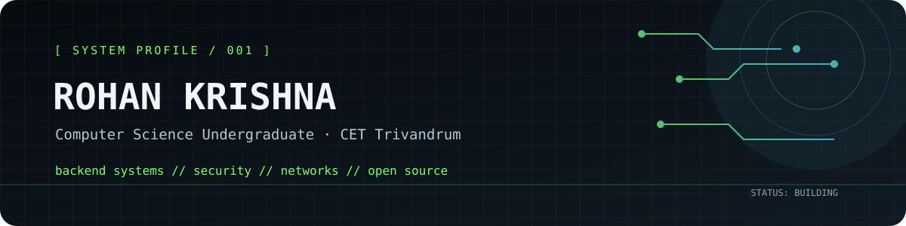

### Computer Science Undergraduate · College of Engineering Trivandrum

*Interested in backend engineering, application security, networking and infrastructure.*

[Projects](#featured-projects) · [Technology Stack](#technology-stack) · [GitHub Activity](#github-activity) · [Connect](#connect)

---

## About

I enjoy building software and understanding how systems work beneath the surface. My interests are in backend engineering, application security, networking, and infrastructure.

I learn by building practical projects, experimenting with technologies, and exploring open source. Currently exploring distributed systems, cloud infrastructure, and AI/ML.

## Featured Projects

<table>
<tr>
<td width="50%" valign="top">

### [Beam](https://github.com/rohan-K210/Beam)

Peer-to-peer chat and file sharing in the browser using WebRTC, with TURN support.

**Technologies:** JavaScript · Node.js · WebRTC

[Source code](https://github.com/rohan-K210/Beam) · [Live demo](https://beam-awcv.onrender.com/)

</td>
<td width="50%" valign="top">

### [Drone SAR Simulator](https://github.com/rohan-K210/Drone-SAR-sim)

A Java desktop simulation for coordinating UAV-assisted search-and-rescue missions.

**Technologies:** Java · Swing · Maven

[Source code](https://github.com/rohan-K210/Drone-SAR-sim)

</td>
</tr>
<tr>
<td width="50%" valign="top">

### [CBSS Banking Software](https://github.com/rohan-K210/CBSS-Banking-software)

An academic banking-management project with loan evaluation, customer segmentation and fraud-detection demonstrations.

**Technologies:** Python · Flask · MySQL · scikit-learn

[Source code](https://github.com/rohan-K210/CBSS-Banking-software)

</td>
<td width="50%" valign="top">

### [ECLIPS](https://github.com/rohan-K210/ECLIPS)

An interactive habitat life-support simulator inspired by environmental control systems.

**Technologies:** Python · Flask · HTML · CSS · JavaScript

[Source code](https://github.com/rohan-K210/ECLIPS)

</td>
</tr>
</table>

## Technology Stack

**Areas of interest:** Backend Engineering · Application Security · Authentication · Computer Networks · WebRTC · Distributed Systems · Open Source

## GitHub Activity

These cards are generated by GitHub Actions and stored in this repository, rather than loaded from an unreliable public stats endpoint. They refresh automatically every day and support both GitHub themes.

<picture>
  <source media="(prefers-color-scheme: dark)" srcset="./assets/overview.dark.svg"/>
  
</picture>

<picture>
  <source media="(prefers-color-scheme: dark)" srcset="./assets/languages.dark.svg"/>
  
</picture>

## Connect

---

*Build thoughtfully. Understand deeply. Keep learning.*

